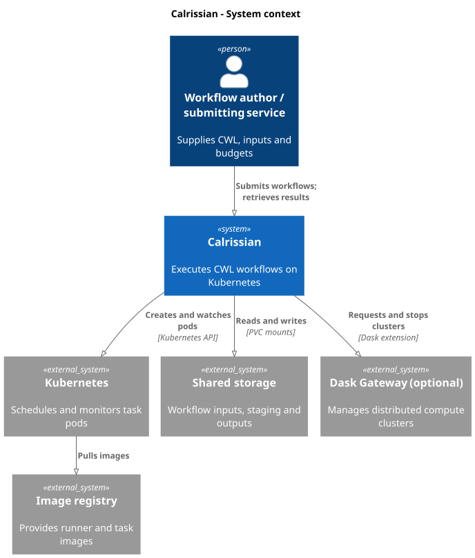
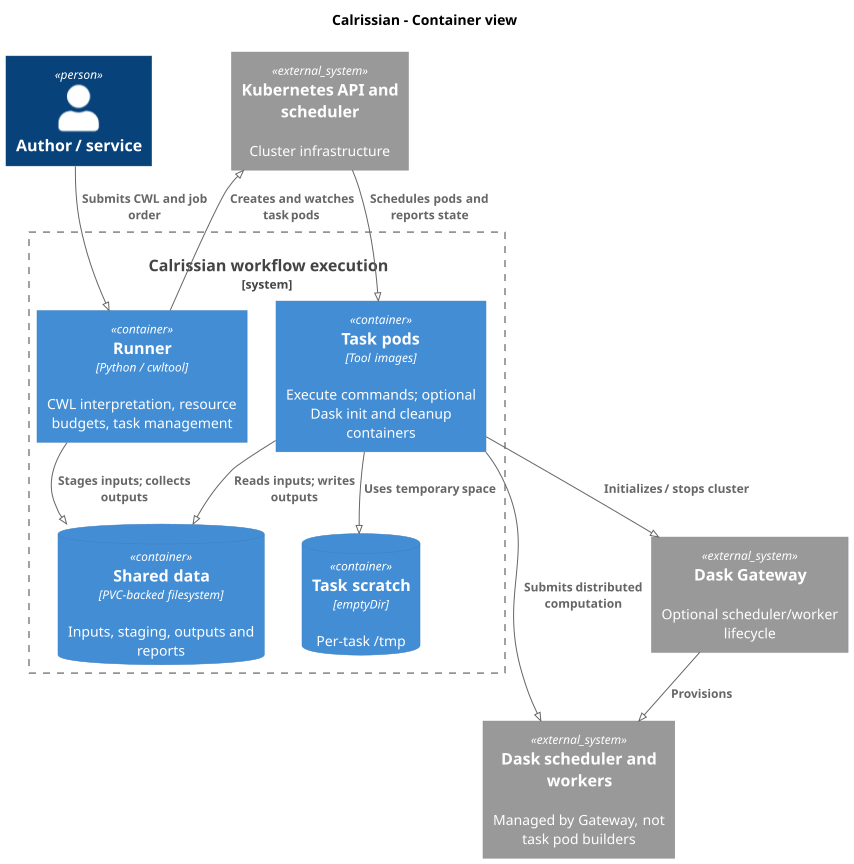
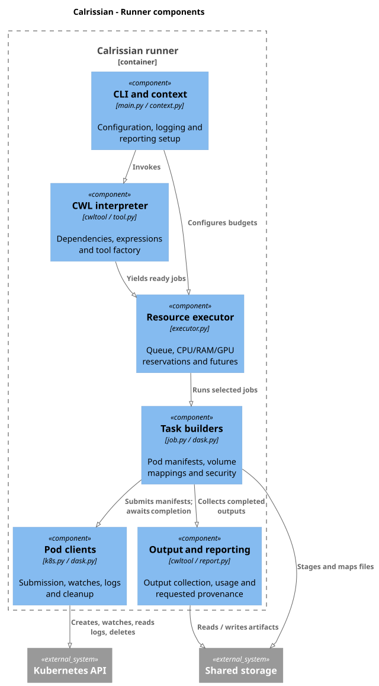

# Calrissian architecture: C4 model

These C4 views describe the implementation, not a proposed redesign. C4
“container” means a deployable/runtime unit; it is not necessarily a Kubernetes
container. Optional Dask workers are managed by Gateway, outside the Calrissian
runner's task-pod lifecycle.

## Level 1: system context

A workflow author or submitting service supplies CWL and input references.
Calrissian executes the workflow through the Kubernetes API and shared storage.
Registries provide task images; an optional Dask Gateway provides distributed
compute for the extension.

[PlantUML source](diagrams/context.puml)

## Level 2: containers

The runner interprets CWL and manages task Pods. It accesses storage using its
own mount paths; task containers can mount the same data at different paths.
Kubernetes schedules those Pods; it does not replace CWL dependency or aggregate
budget management. Tools use per-task scratch volumes in addition to shared data.

[PlantUML source](diagrams/containers.puml)

## Level 3: runner components

The CLI loads configuration, initializes reporting and the executor, and invokes
cwltool with Calrissian's tool factory. The executor schedules ready jobs against
CPU/RAM/GPU budgets. Job builders translate tool execution into Pod manifests;
clients submit and monitor them, while output collection resolves results on
shared storage. Provenance is generated by cwltool when requested.

[PlantUML source](diagrams/components.puml)

The diagrams intentionally omit cloud-specific storage drivers, admission
controllers, and Gateway internals. Those are deployment dependencies, not
components owned by the runner. See [boundaries](boundaries.md) and
[execution](execution.md) for operational consequences.
